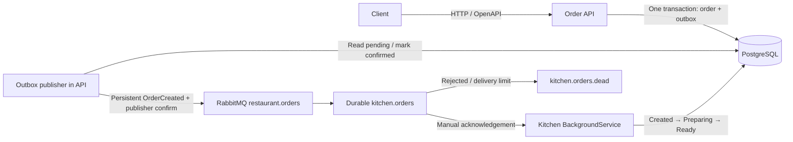

# RestaurantAI — Intelligent Ordering & Kitchen Orchestration

Phase 1: a small .NET 8 ordering API and kitchen background consumer, with PostgreSQL, RabbitMQ, EF Core migrations, Swagger, JSON structured logs, and xUnit tests. No AI, frontend, authentication, or workflow framework.



## Prerequisites and startup

- Docker Desktop with the Linux container engine running and Docker Compose v2.
- .NET 8 SDK or a newer SDK that targets .NET 8, plus .NET 8 runtime, for local builds/tests.
- PowerShell 5.1 or newer for the reproducible smoke script.
- Free localhost ports 55432, 5672, 15672, and 8080.

From the directory containing `RestaurantAI.sln`:

```powershell
docker compose up --build -d
docker compose ps
docker compose logs -f order-api kitchen-worker
```

The API applies the checked-in migration and seeds ten menu items before listening. Compose waits for healthy database/broker, then API, then starts the kitchen. Initial image builds can take several minutes.

- Swagger: http://localhost:8080/swagger
- Menu: http://localhost:8080/api/menu
- Readiness: http://localhost:8080/health/ready
- Liveness: http://localhost:8080/health/live
- RabbitMQ management: http://localhost:15672 — `restaurant` / `restaurant_dev`
- PostgreSQL: localhost:55432, database/user `restaurant`, password `restaurant_dev`

Defaults are for local learning. Ports bind only to localhost. To override secrets and preparation delay, create an untracked `.env` before the first startup:

```dotenv
POSTGRES_PASSWORD=choose-a-local-password
POSTGRES_PORT=55432
RABBITMQ_PASSWORD=choose-another-local-password
KITCHEN_PREPARATION_SECONDS=5
```

Existing database/broker volumes retain their original credentials. `docker compose down` stops the project while preserving data. Removing volumes erases all orders and broker messages.

If Docker restore reports `NU1301` and container curl reports an unknown certificate issuer, a local HTTPS inspection product may have a root trusted by Windows but missing from Linux containers. Export only that existing trusted public root into the ignored build certificate directory, then rebuild. On the development machine Norton HTTPS inspection required:

```powershell
powershell -ExecutionPolicy Bypass -File scripts/export-build-ca.ps1 -Subject 'CN=Norton Web/Mail Shield Root, O=Norton Web/Mail Shield, OU=generated by Norton Antivirus for SSL/TLS scanning'
docker compose up --build -d
```

This affects build-stage trust only; no private key is exported and TLS verification stays enabled. Other machines normally need no extra certificate. For a different proxy, supply the exact subject of its trusted root. Do not commit local certificate files.

## Try an order

```powershell
Invoke-RestMethod http://localhost:8080/api/menu
$body = @{
    customerId = 'aaaaaaaa-aaaa-aaaa-aaaa-aaaaaaaaaaaa'
    items = @(@{
        menuItemId = '00000000-0000-0000-0000-000000000001'
        quantity = 2
        specialInstructions = 'No basil please'
    })
} | ConvertTo-Json -Depth 5
$order = Invoke-RestMethod http://localhost:8080/api/orders -Method Post -ContentType application/json -Body $body
Invoke-RestMethod "http://localhost:8080/api/orders/$($order.id)"
```

POST returns HTTP 201 with a Location header, ID, `Created` status, server-calculated total, timestamps, and item details. Poll GET until `Ready` (normally about six seconds). Prices use decimal with two database decimal places; timestamps are UTC. Quantities must be 1–100, orders must contain 1–50 lines, and each line allows up to 500 characters of optional instructions. Customer IDs must be nonempty GUIDs. Unknown/unavailable menu items return HTTP 400; unknown orders return HTTP 404. Client price fields are ignored. Duplicate item lines are allowed and priced separately.

## Build, migrations, and tests

```powershell
dotnet restore RestaurantAI.sln
dotnet build RestaurantAI.sln --no-restore
dotnet test RestaurantAI.sln --no-build
dotnet tool restore
dotnet ef migrations list --project src/RestaurantAI.Infrastructure --startup-project src/RestaurantAI.OrderApi
dotnet ef database update --project src/RestaurantAI.Infrastructure --startup-project src/RestaurantAI.OrderApi
```

For a custom local database set `$env:ConnectionStrings__Restaurant` before EF commands. To add a schema change:

```powershell
dotnet ef migrations add DescribeChange --project src/RestaurantAI.Infrastructure --startup-project src/RestaurantAI.OrderApi --output-dir Migrations
```

For local processes, start PostgreSQL and RabbitMQ with `docker compose up -d postgres rabbitmq`, then run the API and worker in separate terminals:

```powershell
dotnet run --project src/RestaurantAI.OrderApi --urls http://localhost:8080
dotnet run --project src/RestaurantAI.KitchenWorker --urls http://localhost:8081
```

Local connection defaults match Compose. Configuration uses `ConnectionStrings__Restaurant`, `RabbitMQ__Host`, `RabbitMQ__Username`, `RabbitMQ__Password`, `Kitchen__PreparationSeconds`, and `Database__ApplyMigrations` environment variables. `Database__ApplyMigrations=false` supports externally managed migrations; apply migrations before starting the worker. Worker health endpoints are available on its HTTP port; `/health/consumer` also checks consumer registration.

Automated tests run API requests through ASP.NET Core TestServer and a real SQLite relational database. They cover menu availability, input validation, ignored client prices, order persistence plus outbox, missing orders, kitchen completion, duplicate handling, and interrupted preparation. They need no Docker. SQLite does not validate PostgreSQL-specific behavior; use the complete workflow smoke test for that:

```powershell
docker compose up --build -d
powershell -ExecutionPolicy Bypass -File scripts/smoke-test.ps1
# If RabbitMQ credentials were overridden:
# ./scripts/smoke-test.ps1 -RabbitPassword 'your-password'
```

The script creates a real order, checks server pricing, waits for Ready, publishes a duplicate through RabbitMQ management, verifies its acknowledgement and unchanged order timestamp, then verifies that an invalid event reaches the dead-letter queue. It leaves its orders and dead-letter message available for inspection.

For a recovery test that temporarily stops the project's broker, submits an order during the outage, restores the broker, and then restarts the worker during a second order's preparation:

```powershell
powershell -ExecutionPolicy Bypass -File scripts/recovery-test.ps1
```

Use the default five-second preparation delay for this test so it can observe `Preparing` before restarting the worker.

Verified on 2026-10-16:

- Solution build: zero warnings and errors; 13 xUnit tests passed with no skips.
- Linux .NET 8 container builds and all four Compose services healthy.
- Smoke script passed seeded menu, authoritative pricing, order → outbox → RabbitMQ → Ready, duplicate acknowledgement without changes, and dead-letter routing.
- Recovery script passed order submission during broker outage and resumed preparation after worker restart.
- EF migration matched the model; the documented database update command reported the database up to date.
- OpenAPI exposed all three endpoints. NuGet advisory check, including transitive dependencies, reported no known vulnerable packages after updating the test-only SQLite bundle.

Repeat the dependency check as advisories change:

```powershell
dotnet list RestaurantAI.sln package --vulnerable --include-transitive
```

## Reliability and operational boundaries

- One EF `SaveChanges` transaction saves orders, item prices, and outbox events atomically. A background publisher locks batches using PostgreSQL `FOR UPDATE SKIP LOCKED`, publishes persistent messages with mandatory routing and broker confirmations, and marks the batch published only after confirmation. A crash between confirmation and commit can redeliver; this is intentional at-least-once delivery.
- Durable direct exchange `restaurant.orders` routes `order.created` to durable quorum queue `kitchen.orders`. JSON event fields: `eventId`, `orderId`, `customerId`, `createdAt`.
- Kitchen uses prefetch 1 and manual acknowledgements. Conditional database updates allow only Created → Preparing → Ready. Completed deliveries are acknowledged without writes; interrupted Preparing orders resume. Concurrent duplicate deliveries may simulate preparation more than once, but cannot regress status or complete an order twice. This is suitable for simulated work; real external kitchen side effects will require stronger coordination.
- Transient processing failures get three attempts with bounded backoff, then a non-requeue rejection. Malformed/missing-order events go directly to `kitchen.orders.dead` via `restaurant.orders.dead`. Quorum delivery limit 5 also bounds repeated crash/disconnect deliveries. Inspect failures in management; repair the cause before manually republishing a valid event. No automatic dead-letter replay.
- Initial connection failures retry every five seconds. RabbitMQ automatic connection/topology recovery is enabled; publishers retain unconfirmed outbox records. Shutdown cancels processing and closes channels so unacknowledged events can resume. JSON logs include order/event IDs.
- Database and RabbitMQ have persistent volumes. Single-node quorum queues provide durability, not high availability. A dead-letter transfer uses RabbitMQ's default dead-letter strategy; stronger at-least-once dead-letter guarantees need an explicit broker policy.
- Startup migrations are convenient for one API instance; apply migrations separately before scaling. Outbox rows are retained indefinitely; add cleanup later. There is no POST idempotency key: repeated HTTP POSTs create separate orders. No pagination, authentication, rate limiting, cancellation/refunds, inventory reservations, tracing, or external kitchen side effects. Currency is one implicit currency for this learning project.
- Health readiness verifies database/broker connectivity; it does not guarantee an empty outbox or kitchen throughput. Monitor logs and queue backlog. Swagger is enabled for local learning.

## Future Semantic Kernel integration

Keep AI outside the domain/application services. A future adapter can invoke the existing named OpenAPI operations `GetMenu`, `CreateOrder`, and `GetOrderStatus`. Add a small search/filter endpoint for `SearchMenuItems` when needed. Then add request idempotency keys, tool authorization and confirmation for order placement, timeouts, cancellation, and distributed tracing before introducing multi-agent workflows. Keep server validation/pricing authoritative and use the existing asynchronous event boundary for kitchen orchestration.
